<div align="center">

# 🔥 FIREWORK CHRONOS

### One fire record from 2000 to today — MODIS and VIIRS on a single ruler

**NASA Space Apps Challenge 2026 · Harmonization of MODIS and VIIRS Hot Spots**

[](https://firework-nasa.vercel.app)


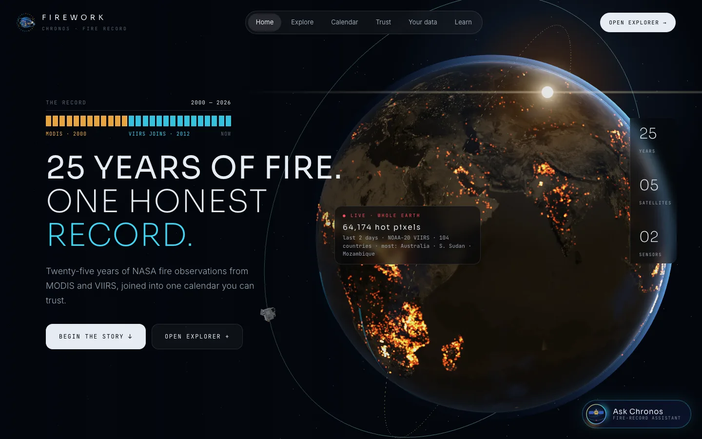

</div>

---

## 🌍 The project in one minute

Satellites have watched Earth's fires for more than 25 years. Since 2000 the **MODIS** instruments on Terra and Aqua have reported hot spots. In 2012 the **VIIRS** instruments arrived on S-NPP, later NOAA-20 and NOAA-21, with pixels about **16 times smaller**. VIIRS sees fires that MODIS cannot.

So when you join the two records, the world seems to burn **about 2.5 times more after 2012**. That jump is not real fire. It comes from a new camera.

**FIREWORK CHRONOS** removes that jump. It puts both records on one common scale, shows how sure it is about every number, and stays empty where it cannot know. The result is one fire history, region by region and month by month, from 2000 to today.

> **Open it:** **https://firework-nasa.vercel.app**

---

## ❗ The problem we solve

<table>
<tr>
<td width="50%">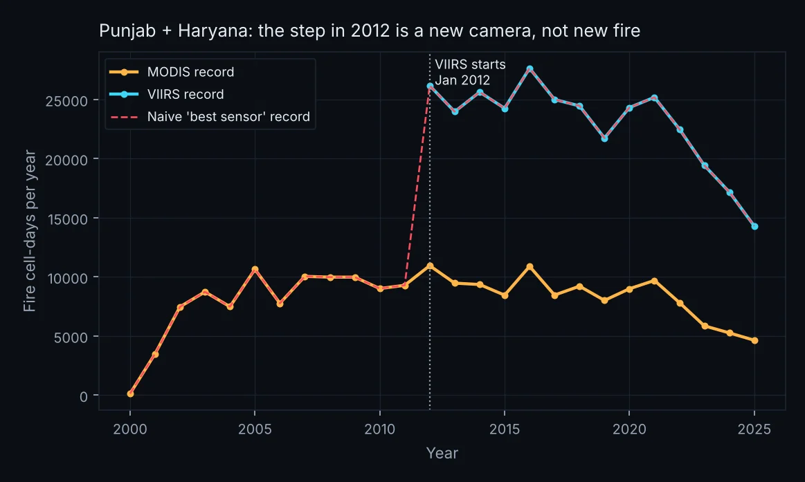</td>
<td width="50%">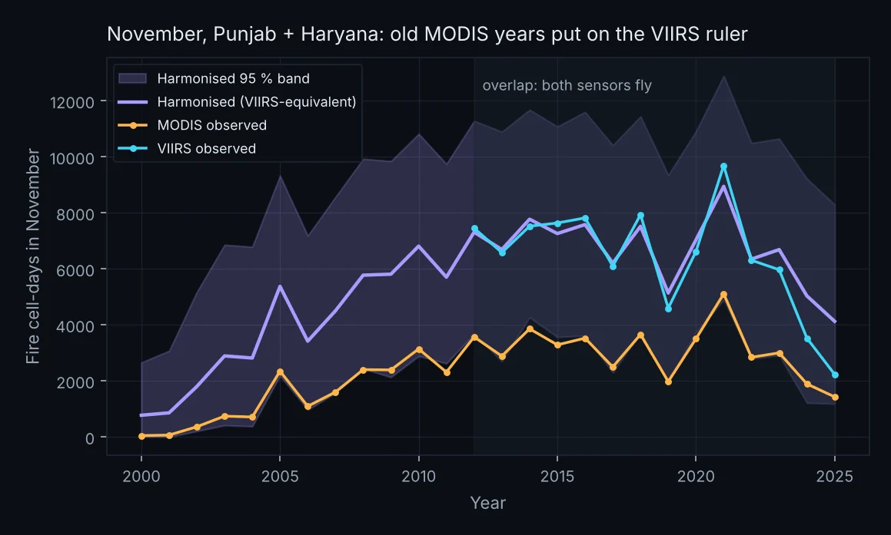</td>
</tr>
<tr>
<td align="center"><b>Before</b> — raw counts jump when VIIRS starts in 2012</td>
<td align="center"><b>After</b> — one harmonised record, no false jump</td>
</tr>
</table>

| Without FIREWORK | With FIREWORK |
|---|---|
| A fake rise in fire at 2012 | One continuous record 2000 → today |
| Two sensors, two answers | One common ruler (VIIRS scale) |
| A "0" may just mean the satellite saw nothing | A 0 only where the region had clear looks; otherwise *no data* |
| Numbers without doubt | Every value carries a range and a status |

---

## ⚙️ How it works

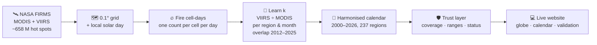

1. **Collect.** All hot spots from NASA FIRMS for five satellites: Terra, Aqua, S-NPP, NOAA-20 and NOAA-21.
2. **Count fairly.** Each detection goes into a 0.1° cell and the **local solar day** of that place, so a cell that burns all day counts once — big pixels and small pixels are treated the same.
3. **Learn the ruler.** In the years both sensors flew (2012–2025) we learn how many VIIRS fire-days match one MODIS fire-day — a factor **k** for each region and month, with a range from resampling whole years.
4. **Rebuild the past.** MODIS years before 2012 are multiplied by k, so the whole record speaks VIIRS.
5. **Say how sure we are.** Every month gets a 95 % range, a status (observed, harmonised, withheld), and is left empty when the satellites had no clear look.

---

## ✨ What you can do on the site

<table>
<tr>
<td width="50%">
<h3>🌐 Explore the globe</h3>
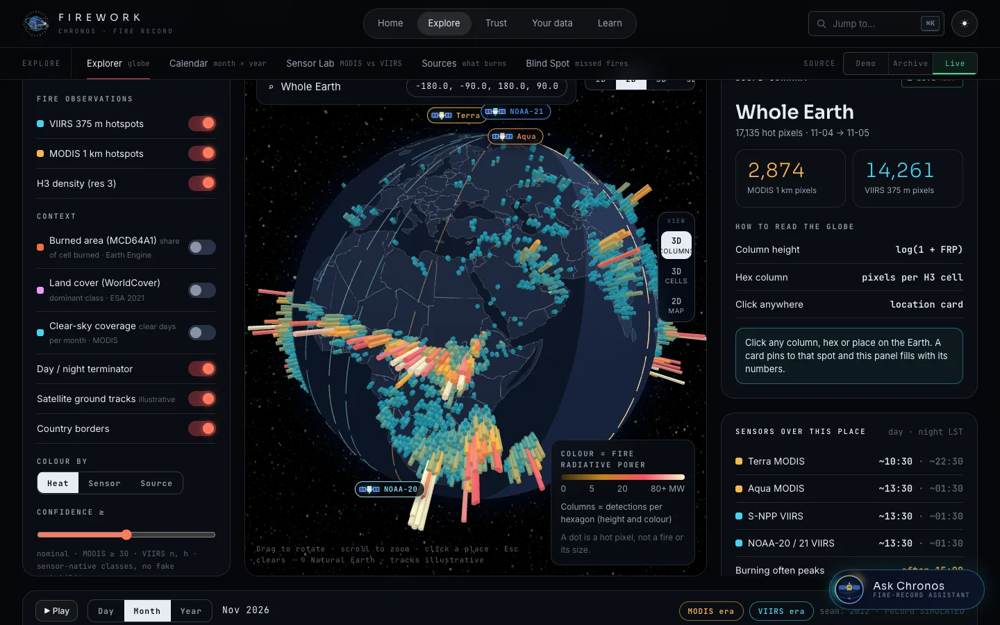<br>
Spin a 3D Earth with live and archive fire points from every satellite.
</td>
<td width="50%">
<h3>📍 Inspect any place</h3>
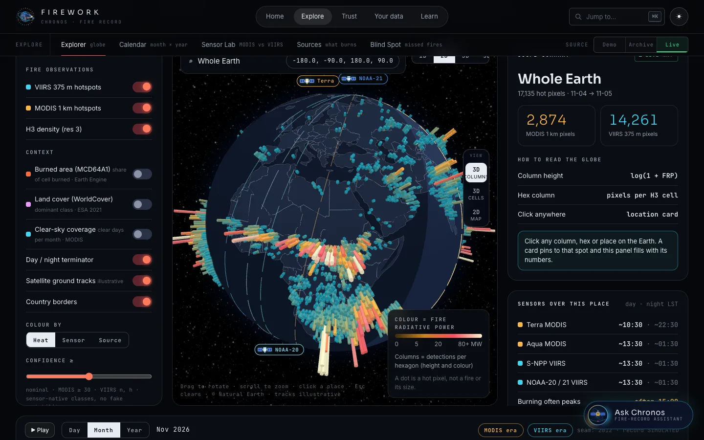<br>
Click anywhere: is it burning, quiet or water? What is normal this month, when is the next satellite pass?
</td>
</tr>
<tr>
<td>
<h3>📅 Fire calendar</h3>
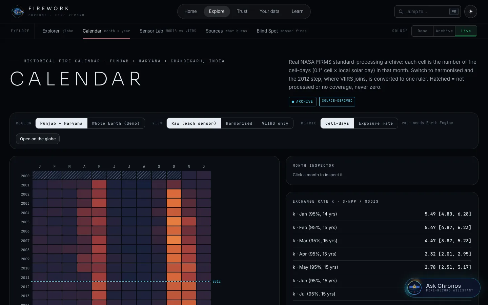<br>
Month-by-month fire for 237 regions, 2000–2026, with ranges on every value.
</td>
<td>
<h3>🛰️ Satellites</h3>
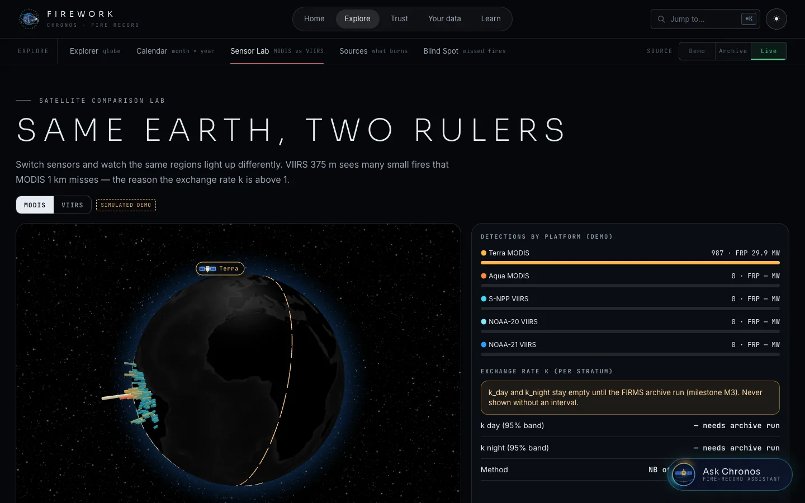<br>
Meet the five instruments, their orbits and what each one can see.
</td>
</tr>
<tr>
<td>
<h3>🕒 Fire clock</h3>
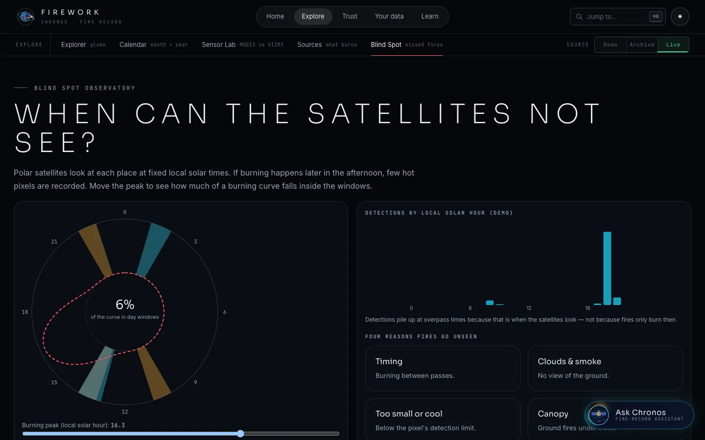<br>
Fires follow the sun. See which hours each satellite watches and which it misses.
</td>
<td>
<h3>✅ Validation</h3>
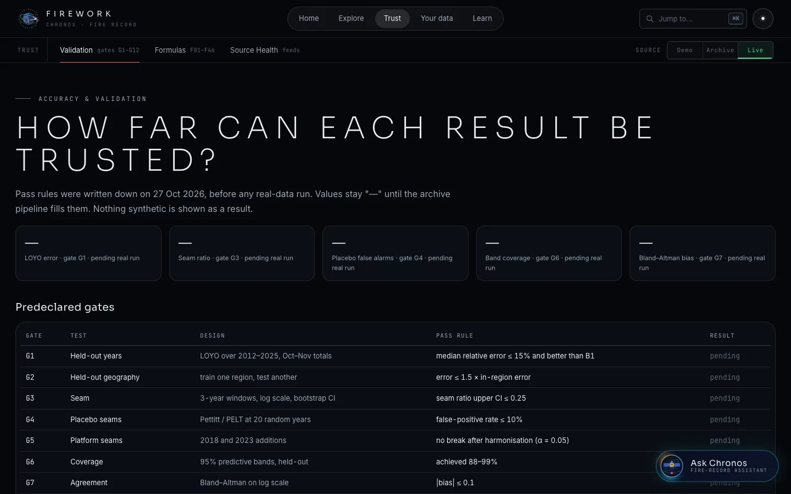<br>
Every test we ran, with the result — passed or failed — and our research paper.
</td>
</tr>
<tr>
<td>
<h3>📐 Formulas</h3>
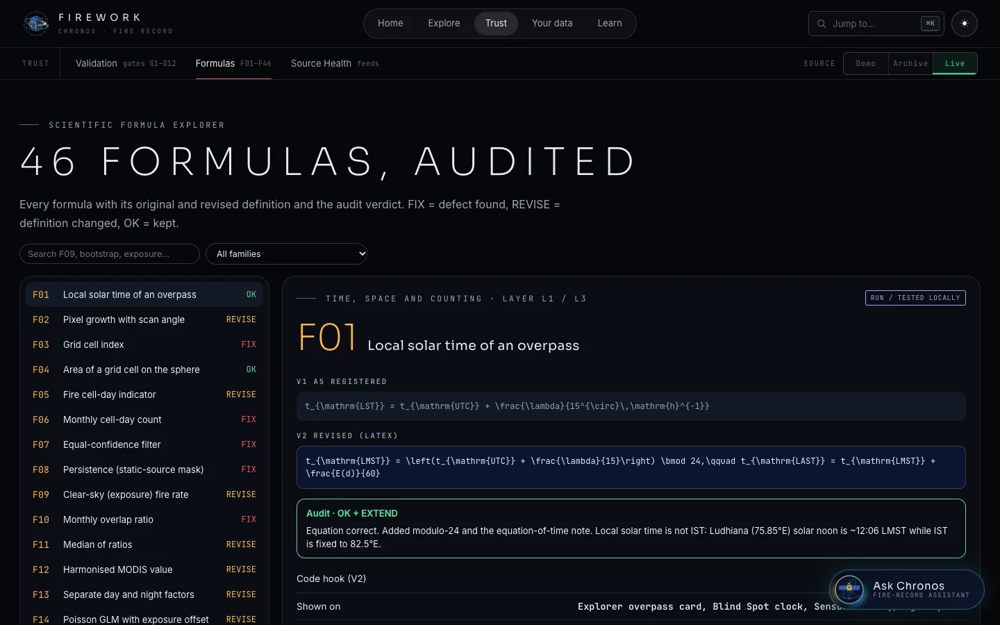<br>
Each step of the method written out, so anyone can check it.
</td>
<td>
<h3>💬 Ask Chronos</h3>
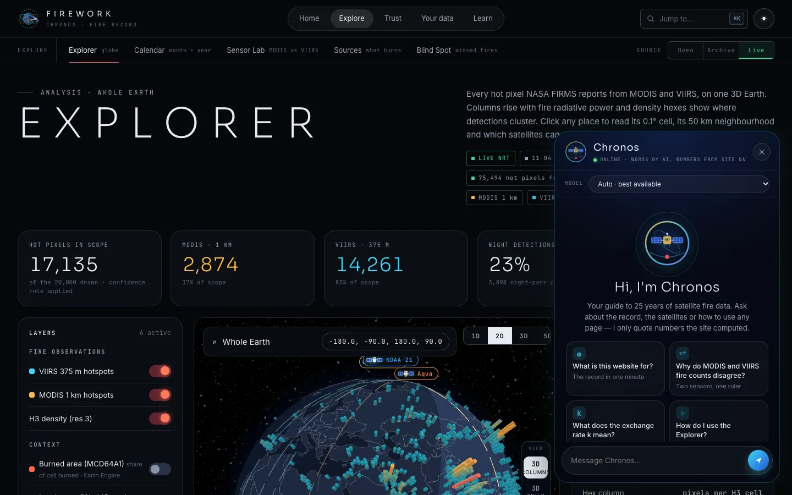<br>
An assistant that answers only from the project's own data and says so when it does not know.
</td>
</tr>
</table>

<div align="center">
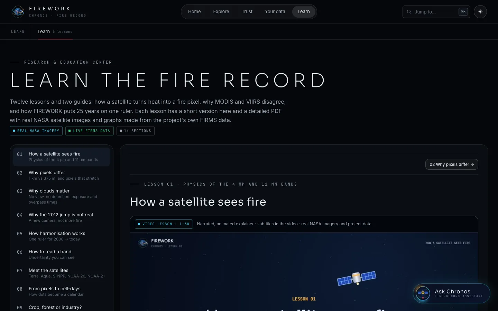<br>
<b>📚 Learn</b> — short lessons on how satellites find fire, from heat physics to pixel size.
</div>

---

## 📊 Results

<div align="center">

| | |
|:---:|:---:|
| **9.7 %** | median error on years the model never saw (limit 15 %) |
| **0.19** | how much of the 2012 jump is left (limit 0.25) |
| **94.76 %** | of 19,984 checks fell inside the 95 % range |
| **−0.012** | bias between sensors after harmonising (limit ±0.1) |
| **ρ 0.689** | agreement with independent burned-area maps, 114 countries |

</div>

> Being honest about limits is part of the method. Full details are on the **[Validation page](https://firework-nasa.vercel.app)**.

---

## 🛰️ Data

| Source | What we use |
|---|---|
| **NASA FIRMS** — MODIS C6.1 (Terra, Aqua) | hot spots 2000 → today |
| **NASA FIRMS** — VIIRS 375 m (S-NPP, NOAA-20, NOAA-21) | hot spots 2012 → today |
| NASA / ESA burned-area products | independent check of the result |
| Natural Earth | country and region borders |

About **658 million** fire points, **5 satellites**, **237 regions**, **2000–2026**.

---

## 🧰 Built with


<details>
<summary><b>Run it yourself</b></summary>

```bash
cd frontend && npm install && npm run dev
```

```bash
cd backend && pip install -r requirements.txt && uvicorn app.main:app --reload --port 8000
```

</details>

---

## 👥 Team

<div align="center">

**Mritunjay Sahu** · **Dhruv Sharma** · **Muskaan Ramrakhyani** · **Shyamli Bakale**

</div>

---

## 🙏 Credits and notes

- Fire data: **NASA FIRMS** (Fire Information for Resource Management System), LANCE and the MODIS and VIIRS science teams.
- NASA does not endorse this project. NASA names and data are used under NASA's media and data guidelines.
- AI tools helped with parts of the code and writing; all results were checked by the team.
- FIREWORK is a research and decision-support tool. **It is not an emergency fire alert system.**

<div align="center">

**[🔥 Open FIREWORK CHRONOS](https://firework-nasa.vercel.app)**

</div>
